<div align="center">
  
</div>

<h1 align="center">Master Data Engineer</h1>

<p align="center">
  <strong>Uma equipe de agentes de IA para Engenharia de Dados no Databricks — dentro do Claude Code e do Codex.</strong><br/>
  Construa, revise e depure pipelines com Python, PySpark e SQL, e acompanhe a equipe trabalhando em tempo real.
</p>

<p align="center">
  <a href="https://github.com/carlos-dataengineer/master-data-engineer/actions/workflows/ci.yml"></a>
  
  
  
  
  
  
</p>

<p align="center">
  <a href="#-instalação-em-um-comando">Instalação</a> ·
  <a href="#-como-usar">Como usar</a> ·
  <a href="#-painel-da-equipe-em-tempo-real">Painel</a> ·
  <a href="#-casos-de-uso">Casos de uso</a> ·
  <a href="#️-atalhos">Atalhos</a> ·
  <a href="#-perguntas-frequentes">FAQ</a>
</p>

---

## ⚡ Em 30 segundos

```powershell
# Windows (PowerShell)
irm https://raw.githubusercontent.com/carlos-dataengineer/master-data-engineer/main/install.ps1 | iex
```

```bash
# macOS / Linux
curl -fsSL https://raw.githubusercontent.com/carlos-dataengineer/master-data-engineer/main/install.sh | bash
```

Um comando e pronto:

1. a skill **`dataengineer`** e os **8 agentes especialistas** são instalados no **Claude Code** e no **Codex**;
2. a ferramenta — o **Painel da equipe** — é **gerada automaticamente** na sua máquina e **abre no navegador**;
3. no Claude Code, hooks passam a registrar sozinhos cada agente que começa ou termina uma tarefa.

Depois, abra uma sessão nova e digite **`/dataengineer`** (Claude Code) ou **`$dataengineer`** (Codex).

<p align="center">
  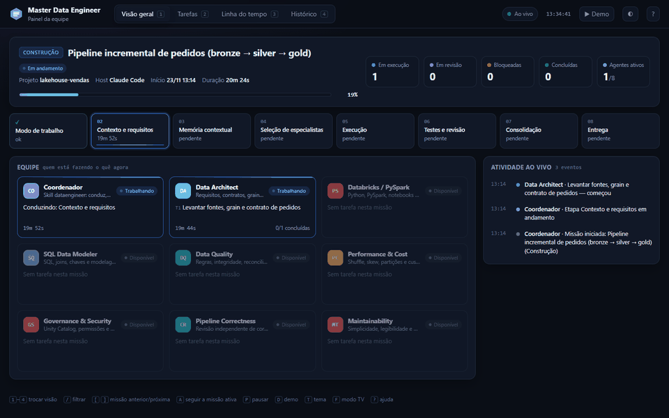
  <br/><sub>O painel acompanhando uma missão: etapas avançando, agentes começando, revisando, bloqueando e concluindo tarefas.</sub>
</p>

## 🧭 O que é

O **Master Data Engineer** transforma o seu Claude Code ou Codex em uma **equipe sênior de Engenharia de Dados**. Em vez de conversar com um assistente genérico, você aciona um **coordenador** que entende o trabalho, convoca só os especialistas necessários, distribui as tarefas, revisa os resultados de forma independente e entrega com evidências.

**O foco é 100% Engenharia de Dados no Databricks.** Não é uma equipe para sites, aplicativos ou sistemas. Os agentes, os critérios de revisão e os fluxos foram pensados para o ciclo de vida de pipelines: ingestão, transformação, modelagem, qualidade, performance, custo e governança — com **Python, PySpark e SQL**.

| | |
|---|---|
| 🧑‍✈️ **Um ponto de entrada** | `/dataengineer` pergunta o modo (construir, revisar, depurar) e conduz o resto. |
| 👥 **8 especialistas** | Arquitetura, PySpark, SQL, qualidade, performance, governança e duas revisões independentes. |
| 📺 **Painel em tempo real** | Veja a etapa atual, o que cada agente está fazendo e o histórico de missões. |
| 🧠 **Memória contextual** | A equipe lembra preferências e decisões confirmadas, isoladas por projeto. |
| 🔒 **Local e seguro** | Sem telemetria; painel só em `127.0.0.1`; nada executa no Databricks sem sua autorização. |
| 🔁 **Claude Code e Codex** | Mesma equipe nos dois hosts, cada um no seu formato nativo. |

## 📦 Instalação em um comando

**Pré-requisitos:** Python 3.10+ e o Claude Code e/ou o Codex instalados. Nenhuma biblioteca extra é necessária.

<p align="center">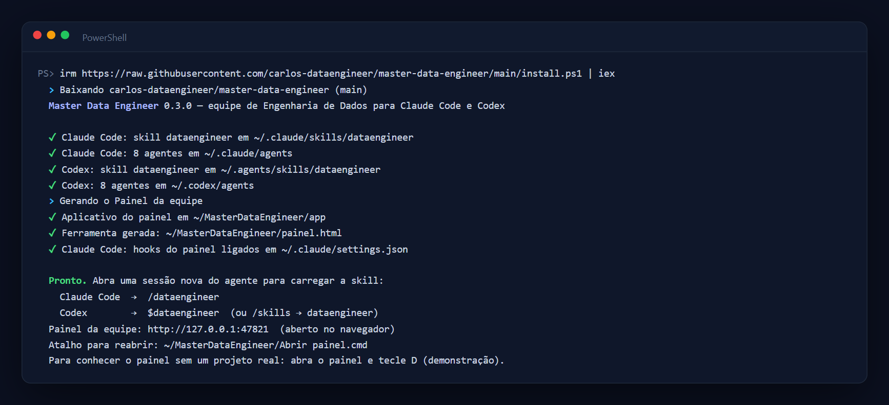</p>

### O que a instalação cria

| Onde | O quê |
|---|---|
| `~/.claude/skills/dataengineer/` | Skill coordenadora para o Claude Code (com scripts de memória e do painel) |
| `~/.claude/agents/*.md` | Os 8 agentes no formato do Claude Code |
| `~/.agents/skills/dataengineer/` | Skill para o Codex (com `agents/openai.yaml` para o menu `/skills`) |
| `~/.codex/agents/*.toml` | Os 8 agentes no formato do Codex |
| `~/.claude/settings.json` | 2 hooks (`PreToolUse`/`PostToolUse` da ferramenta de subagentes), com cópia de segurança em `settings.json.bak-mde` |
| `~/MasterDataEngineer/painel.html` | **A ferramenta gerada:** o Painel da equipe em um arquivo único |
| `~/MasterDataEngineer/Abrir painel.cmd` · `abrir-painel.sh` | Atalho para reabrir o painel a qualquer momento |
| `~/MasterDataEngineer/board/` | Histórico de missões (eventos locais, só títulos curtos) |

Ao final, o instalador **sobe o painel em `http://127.0.0.1:47821` e abre no navegador**. Ainda sem nenhuma missão? Tecle **D** para ver uma demonstração.

### Opções

| Windows (`$env:...` antes do comando) | macOS/Linux (`... \| bash -s -- <opção>`) | Efeito |
|---|---|---|
| `MDE_SKIP_CLAUDE=1` | `--skip-claude` | Não instala no Claude Code |
| `MDE_SKIP_CODEX=1` | `--skip-codex` | Não instala no Codex |
| `MDE_NO_HOOKS=1` | `--no-hooks` | Não altera o `settings.json` (o painel continua funcionando pelo coordenador) |
| `MDE_NO_OPEN=1` | `--no-open` | Não abre o navegador |
| `DATAENGINEER_HOME=D:\MDE` | `--home <pasta>` | Outra pasta para o painel e o histórico |
| `MDE_REF=v0.3.0` | `--ref v0.3.0` | Instala uma versão específica |

Com o repositório clonado, também é possível:

```powershell
.\install.ps1                                   # instala para o seu usuário
.\install.ps1 -Project C:\caminho\do\projeto    # instala só em um projeto
.\install.ps1 -Uninstall                        # remove (mantém histórico e memória)
.\install.ps1 -Uninstall -Purge                 # remove também o histórico do painel
```

<details>
<summary><b>Alternativa: marketplace de plugins do Claude Code</b></summary>

```text
/plugin marketplace add carlos-dataengineer/master-data-engineer
/plugin install dataengineer@master-data-engineer
```

Nesse caminho a skill e os agentes vêm pelo sistema de plugins (o comando fica `/dataengineer:dataengineer`) e os hooks automáticos não são ligados; o painel funciona pelos registros do coordenador. Para a experiência completa, prefira o instalador.
</details>

**Atualizar** = rodar o mesmo comando de instalação de novo. Ele só substitui o que ele mesmo instalou; uma skill ou agente de mesmo nome vindo de outra origem é preservado (use `--force`/`-Force` para substituir).

## 🚀 Como usar

### 1. Acione a equipe

| Host | Comando |
|---|---|
| **Claude Code** | `/dataengineer` |
| **Codex** | `$dataengineer` ou `/skills` → `dataengineer` |
| **Só abrir o painel** | `/dataengineer painel` |

### 2. Escolha o modo

Toda ativação começa com a mesma pergunta — a equipe **não começa a mexer em arquivos antes da sua resposta**:

| Modo | Quando usar | O que você recebe |
|---|---|---|
| **1. Construir** | Criar um pipeline do zero | Requisitos confirmados, desenho enxuto, código PySpark/SQL, testes e documentação |
| **2. Revisar** | Avaliar um pipeline existente | Achados com severidade, evidência, cenário de reprodução, impacto e recomendação |
| **3. Depurar** | Erro ou resultado incorreto | Causa raiz, correção mínima, teste de regressão e evidência antes/depois |

### 3. Acompanhe no painel

Logo após a escolha do modo, o coordenador sobe o painel (se ainda não estiver no ar), mostra o endereço e registra a missão. A partir daí, cada etapa e cada tarefa delegada aparecem **ao vivo**.

### 4. Receba a entrega

A resposta final sempre traz: resultado, decisões, arquivos/objetos afetados, **validações realmente executadas** e pendências. A equipe nunca afirma que um Job rodou no Databricks sem evidência do workspace.

### Exemplo de conversa

```text
Você:    /dataengineer
Equipe:  Qual trabalho vamos fazer? 1) Construir  2) Revisar  3) Depurar
Você:    1 — pipeline incremental de pedidos, bronze → silver → gold, no Unity Catalog
Equipe:  Painel da equipe: http://127.0.0.1:47821
         Antes de desenhar: qual é o grain da silver? A chave natural é (pedido_id, item_seq)?
         A carga é diária ou contínua? Existe reprocessamento de dias anteriores?
Você:    Grain = item do pedido; chave confirmada; diária com reprocesso de 7 dias.
Equipe:  [Data Architect]  contrato e fluxo  →  [PySpark] Auto Loader na bronze
         [SQL Modeler] MERGE da silver  →  [Data Quality] expectativas
         [Governance] grants e secrets  →  revisões independentes  →  entrega
```

## 📺 Painel da equipe em tempo real

O painel responde, a qualquer momento: **qual missão está rodando, em que etapa ela está e o que cada agente está fazendo agora.**

<p align="center">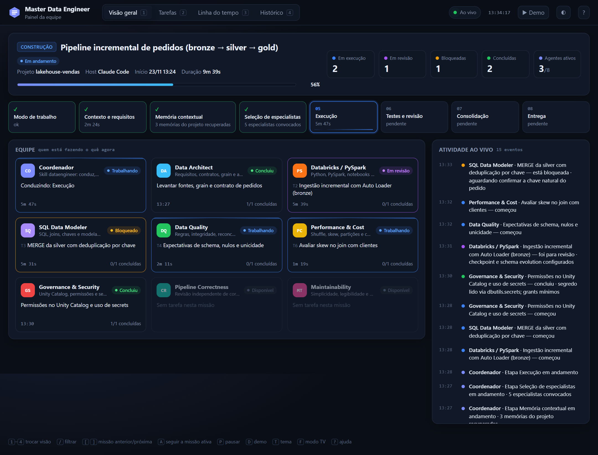</p>

**Visão geral (tecla 1)** — cabeçalho da missão (modo, projeto, host, início, duração, progresso), contadores (em execução, em revisão, bloqueadas, concluídas, agentes ativos), as **8 etapas** do fluxo, um cartão por agente com a **tarefa atual e há quanto tempo** está nela, e o **feed de atividade ao vivo**.

| Tarefas (tecla 2) | Linha do tempo (tecla 3) |
|---|---|
| 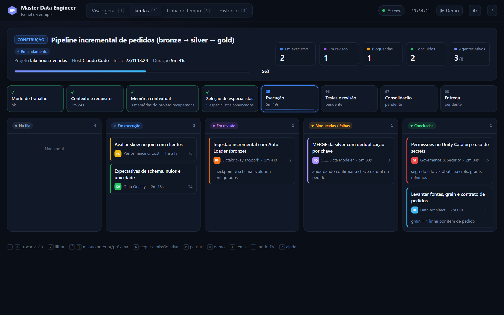 | 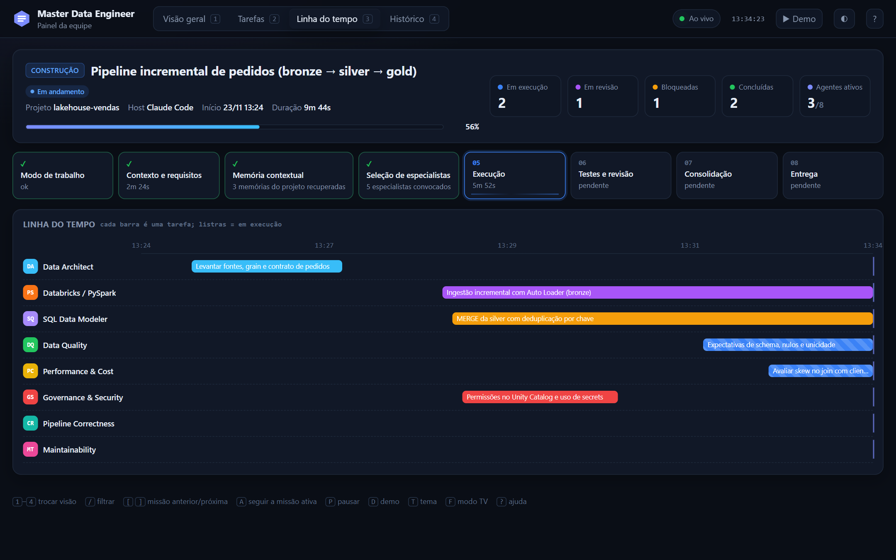 |
| Quadro em colunas: na fila, em execução, em revisão, bloqueadas/falhas e concluídas, com agente, duração e nota de cada tarefa. Tecle **/** para filtrar. | Uma raia por agente; cada barra é uma tarefa do início ao fim. Barras listradas estão em execução; a linha vertical marca o agora. |

| Histórico (tecla 4) | Tema claro (tecla T) |
|---|---|
| 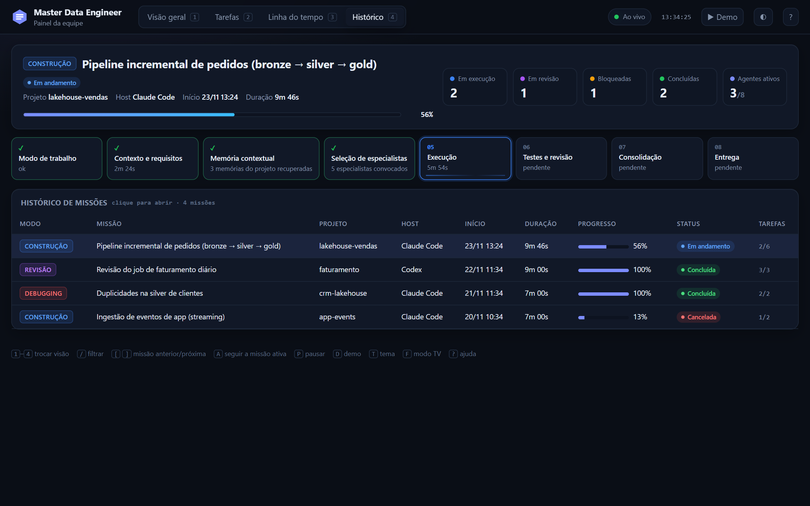 | 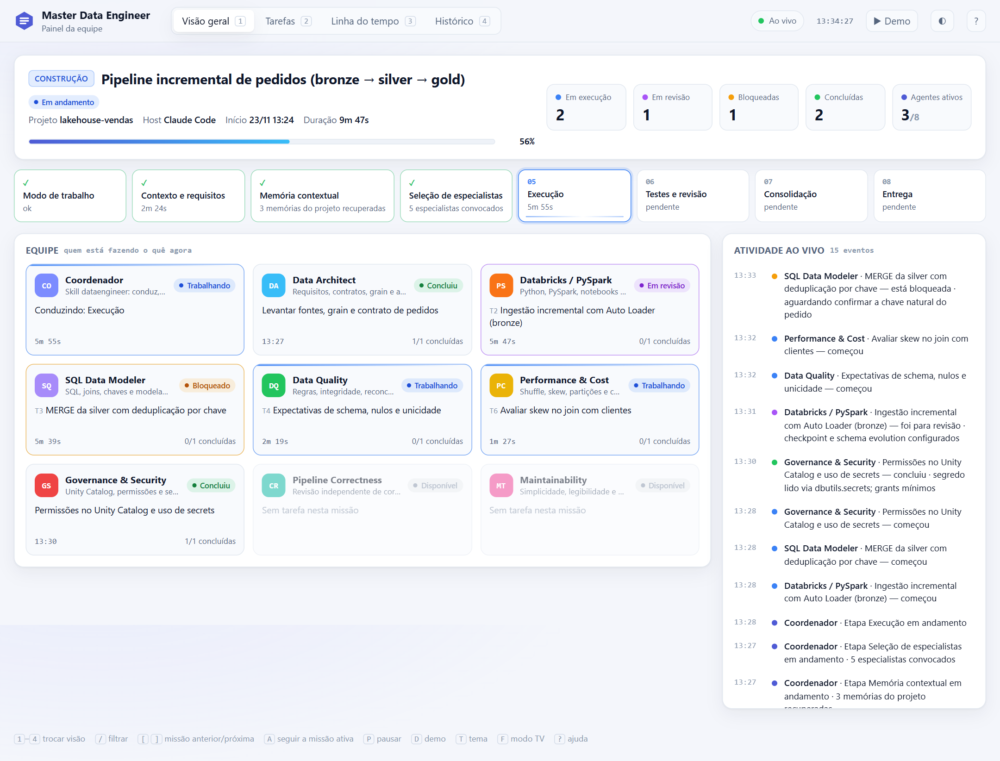 |
| Todas as missões, com modo, projeto, host, duração, progresso e status. Clique para abrir uma missão antiga; **A** volta a seguir a ativa. | Claro ou escuro, lembrado entre sessões. **F** liga o modo TV, ideal para deixar no telão do time. |

<table><tr>
<td width="32%">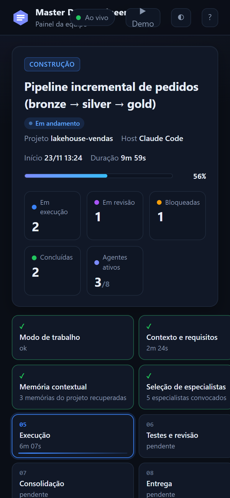</td>
<td><b>Funciona em qualquer tela.</b> O layout se adapta ao celular e ao tablet.<br/><br/>
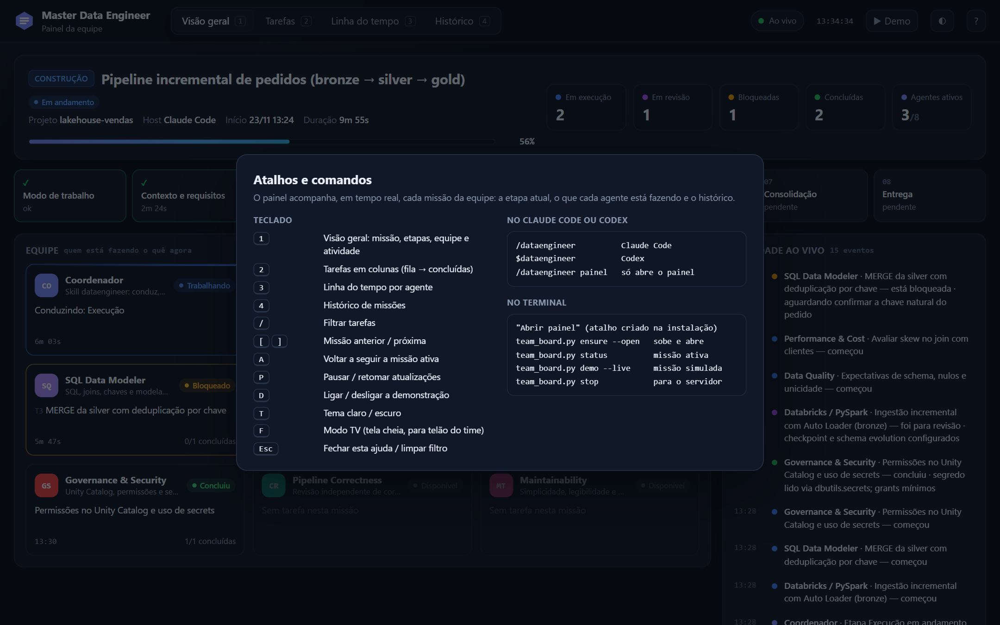<br/>
<b>Tecla ?</b> abre a ajuda com todos os atalhos e comandos.</td>
</tr></table>

### As 8 etapas de uma missão

| # | Etapa | O que acontece |
|---|---|---|
| 1 | Modo de trabalho | Você escolhe construir, revisar ou depurar |
| 2 | Contexto e requisitos | Fontes, destinos, grain, chaves, SLA, regras — e as perguntas que faltam |
| 3 | Memória contextual | A equipe recupera preferências e decisões confirmadas deste projeto |
| 4 | Seleção de especialistas | O coordenador escolhe só os agentes necessários |
| 5 | Execução | Implementação ou análise, em paralelo quando as tarefas são independentes |
| 6 | Testes e revisão | Qualidade de dados e revisões independentes de corretude e manutenção |
| 7 | Consolidação | O coordenador resolve divergências e junta as evidências |
| 8 | Entrega | Resultado, decisões, validações executadas e pendências |

### Status de uma tarefa

`Na fila` → `Em execução` → `Em revisão` → `Concluída` · ou `Bloqueada` (depende de você) · ou `Falhou`.

### Como o painel sabe o que está acontecendo

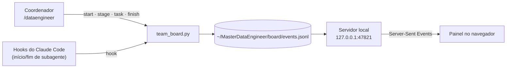

- **O coordenador** registra a missão, cada etapa e cada tarefa que delega (no Claude Code e no Codex).
- **Os hooks** (Claude Code) registram sozinhos quando um subagente começa e termina — mesmo que o coordenador esqueça — e se ligam à tarefa que ele anunciou.
- **O servidor** é somente leitura, só escuta em `127.0.0.1` e envia cada mudança ao navegador na hora.
- **O arquivo `painel.html`** funciona de duas formas: se o servidor estiver no ar, ele se conecta; se não, mostra a última foto salva e a demonstração.

### Comandos do painel no terminal

```bash
python ~/MasterDataEngineer/app/scripts/team_board.py ensure --open   # sobe (se preciso) e abre
python ~/MasterDataEngineer/app/scripts/team_board.py status          # missão ativa em texto
python ~/MasterDataEngineer/app/scripts/team_board.py demo --live     # missão simulada, ao vivo
python ~/MasterDataEngineer/app/scripts/team_board.py stop            # para o servidor
python ~/MasterDataEngineer/app/scripts/team_board.py prune --keep 30 # limpa o histórico antigo
```

Detalhes completos em [docs/painel.md](docs/painel.md).

## ⌨️ Atalhos

| Tecla | Ação | Tecla | Ação |
|---|---|---|---|
| `1` | Visão geral | `[` / `]` | Missão anterior / próxima |
| `2` | Tarefas | `A` | Voltar a seguir a missão ativa |
| `3` | Linha do tempo | `P` | Pausar / retomar atualizações |
| `4` | Histórico | `D` | Ligar / desligar a demonstração |
| `/` | Filtrar tarefas | `T` | Tema claro / escuro |
| `?` | Ajuda | `F` | Modo TV (tela cheia) |
| `Esc` | Fechar ajuda / limpar filtro | | |

Parâmetros de URL úteis: `?view=tasks`, `?theme=light`, `?demo=1`.

## 👥 Os oito especialistas

O coordenador escolhe quem participa de acordo com a tarefa — **não convoca todos por padrão** — e mantém a responsabilidade pela consolidação final.

| Agente | Responsabilidade |
|---|---|
| **Data Architect** | Requisitos, arquitetura, contratos, grain, dependências e fluxo dos dados |
| **Databricks / PySpark Engineer** | Python, PySpark, DataFrames, notebooks, Jobs e recursos do Databricks |
| **SQL Data Modeler** | SQL, joins, chaves, granularidade e modelagem |
| **Data Quality Engineer** | Regras de qualidade, integridade, reconciliação e testes de regressão |
| **Performance & Cost Engineer** | Planos de execução, shuffle, skew, particionamento e custo |
| **Governance & Security Reviewer** | Unity Catalog, permissões, segredos e proteção dos dados |
| **Pipeline Correctness Reviewer** | Revisão independente de lógica, perdas, duplicidades e regressões |
| **Maintainability Reviewer** | Simplicidade, legibilidade, organização e manutenção |

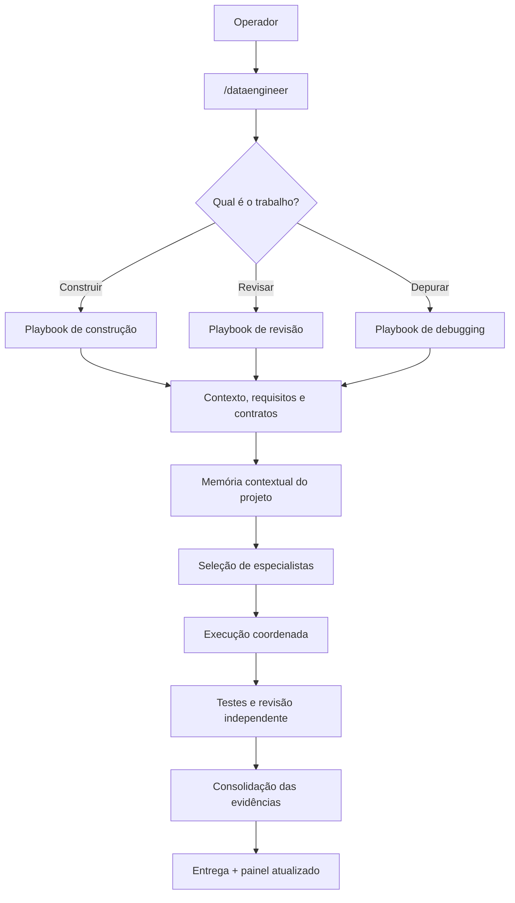

Mais em [docs/agents.md](docs/agents.md), [docs/operating-modes.md](docs/operating-modes.md) e [docs/architecture.md](docs/architecture.md).

## 💡 Casos de uso

| Situação | Modo | Quem a equipe costuma convocar |
|---|---|---|
| Novo pipeline incremental bronze → silver → gold com Auto Loader e `MERGE` | Construir | Architect, PySpark, SQL, Quality, Governance + revisores |
| Migrar uma carga full diária para CDC/incremental sem duplicar dados | Construir | Architect, SQL, Quality, Correctness |
| Revisar um PR com notebooks e SQL antes de ir para produção | Revisar | Correctness, Maintainability (Performance/Governance conforme o risco) |
| Job ficou 4× mais lento depois de uma mudança | Depurar | Performance & Cost, PySpark, Correctness |
| Contagem da gold não bate com a origem | Depurar | Quality, SQL, Correctness |
| Duplicidades depois de um reprocessamento | Depurar | PySpark, SQL, Quality |
| Auditar permissões e uso de segredos de um conjunto de Jobs | Revisar | Governance & Security, Maintainability |
| Definir expectativas de qualidade para tabelas críticas | Construir | Quality, SQL, Architect |
| Acompanhar no telão o trabalho da equipe durante uma sessão longa | — | Painel em modo TV (`F`) |

Exemplos detalhados, com o que pedir e o que esperar, em [docs/casos-de-uso.md](docs/casos-de-uso.md).

## 🧠 Aprendizado contextual

A equipe guarda **preferências e decisões confirmadas** e as recupera em sessões futuras — por exemplo, “neste projeto, a silver usa `MERGE` com chave `(pedido_id, item_seq)`”.

- Memória **local** (SQLite), persistente, **separada por operador e por projeto**: um projeto nunca recebe memórias de outro.
- Inferências ficam como **candidatas** até você confirmar.
- **Não é fine-tuning** e não altera os pesos do modelo; é memória externa estruturada.
- Sem rede, telemetria ou sincronização. O SQLite não é criptografado: não guarde segredos nem dados pessoais.

Detalhes e limites em [docs/contextual-learning.md](docs/contextual-learning.md).

## 🔒 Segurança e privacidade

- Nenhum script envia dados para fora da sua máquina (o instalador só baixa este repositório).
- O painel escuta apenas em `127.0.0.1`, é somente leitura e não libera a API para outros sites.
- Títulos de tarefas que parecem credenciais são trocados por um aviso antes de serem gravados.
- O instalador guarda uma cópia do `settings.json` antes de adicionar hooks e os remove na desinstalação.
- A equipe não executa Jobs de produção, operações destrutivas, mudanças de permissão ou deploy sem sua autorização explícita.

Veja [SECURITY.md](SECURITY.md).

## ❓ Perguntas frequentes

<details><summary><b>O painel não abre ou aparece “Offline”.</b></summary>

Use o atalho **Abrir painel** em `~/MasterDataEngineer` ou rode `team_board.py ensure --open`. Se a porta 47821 estiver ocupada, o painel usa a próxima livre e o endereço aparece no terminal. Para fixar outra porta, use a variável `DATAENGINEER_BOARD_PORT`.
</details>

<details><summary><b>Os agentes não aparecem no painel quando são chamados.</b></summary>

No Claude Code, confirme os hooks em `~/.claude/settings.json` (procure `team_board.py" hook`) e abra uma sessão nova. No Codex não há hooks: o painel depende dos registros do coordenador, que a skill já faz em cada etapa e tarefa.
</details>

<details><summary><b>Preciso de acesso ao Databricks?</b></summary>

Não para usar a equipe: ela lê arquivos, desenha, escreve código e testes. Para executar e validar Jobs reais você precisa das suas próprias ferramentas e conexões; a equipe deixa claro o que foi validado de fato e o que não foi.
</details>

<details><summary><b>Posso usar só no Claude Code ou só no Codex?</b></summary>

Sim: `MDE_SKIP_CODEX=1` ou `MDE_SKIP_CLAUDE=1` (Windows) / `--skip-codex` ou `--skip-claude` (macOS/Linux).
</details>

<details><summary><b>Como desinstalo?</b></summary>

Rode o instalador com `-Uninstall` (Windows) ou `--uninstall` (macOS/Linux). Skills, agentes, hooks e o aplicativo do painel são removidos; o histórico de missões só sai com `-Purge`/`--purge`, e a memória contextual fica até você apagá-la.
</details>

## 🗂️ Estrutura do repositório

```text
master-data-engineer/
├── install.ps1 · install.sh          # instalação em um comando
├── scripts/
│   ├── install.py                    # núcleo do instalador
│   └── screenshots.py                # gera as imagens deste README
├── dataengineer/                     # o pacote (também é o plugin do Claude Code)
│   ├── skills/dataengineer/
│   │   ├── SKILL.md                  # coordenador: modos, playbooks, protocolo do painel
│   │   ├── agents/openai.yaml        # metadados para o menu /skills do Codex
│   │   ├── scripts/team_board.py     # painel: eventos, hooks, servidor, demo, exportação
│   │   ├── scripts/contextual_memory.py
│   │   ├── assets/painel.html        # interface do painel
│   │   └── references/               # memória contextual e checklist técnico
│   ├── agents/*.md                   # 8 agentes (Claude Code)
│   ├── .codex/agents/*.toml          # 8 agentes (Codex)
│   └── docs/ · tests/
├── tests/                            # testes do instalador
├── docs/                             # documentação e capturas de tela
└── .github/                          # CI, modelos de issue e PR
```

## 🤝 Contribuindo

Leia o [CONTRIBUTING.md](CONTRIBUTING.md). Os testes rodam só com a biblioteca padrão:

```bash
python dataengineer/tests/validate_package.py
python -m unittest discover -s dataengineer/tests -p "test_*.py"
python -m unittest discover -s tests -p "test_*.py"
```

## 📚 Créditos e referências

Usei três projetos públicos como referência de arquitetura e critérios de qualidade: [Pstack](https://github.com/cursor/plugins/tree/main/pstack) (orquestração por skill central e playbooks), [Thermos](https://github.com/cursor/plugins/tree/main/thermos) (revisão independente) e [Ponytail](https://github.com/DietrichGebert/ponytail) (simplicidade e foco na causa raiz). Esta é uma implementação própria para Engenharia de Dados, não uma cópia nem distribuição oficial desses projetos. Veja [THIRD_PARTY_NOTICES.md](THIRD_PARTY_NOTICES.md).

## 📄 Licença

[MIT](LICENSE). Histórico de versões em [CHANGELOG.md](CHANGELOG.md).

---

<p align="center"><strong>Uma equipe para pensar, construir, revisar e corrigir pipelines de dados — e que você vê trabalhando.</strong></p>
