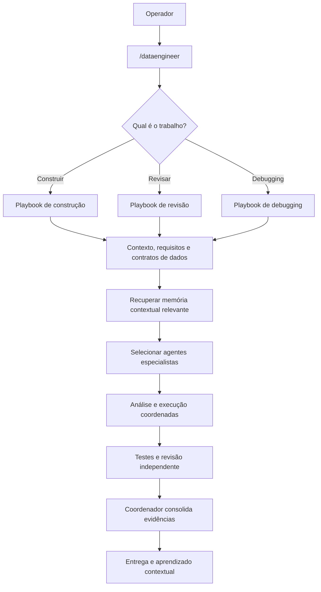
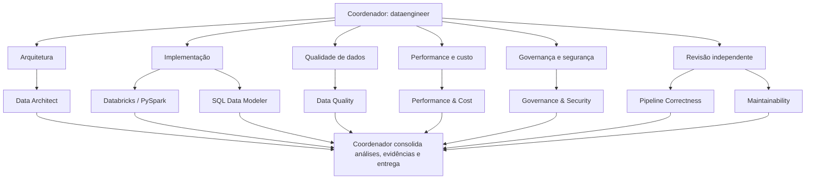
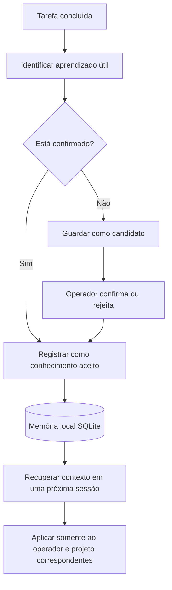

<div align="center">
  
</div>

<h1 align="center">Master Data Engineer</h1>

<p align="center">
  <strong>Uma equipe de agentes de IA criada exclusivamente para Engenharia de Dados no Databricks.</strong><br/>
  Python, PySpark e SQL para construir, revisar e corrigir pipelines com um único ponto de entrada.
</p>

<p align="center">
  
  
  
  
  
</p>

## Por que criei este projeto

Criei o **Master Data Engineer** para ter uma equipe de engenharia que me ajude a trabalhar com pipelines no Databricks de uma forma mais organizada, técnica e consistente.

A ideia é reunir diferentes especialidades em uma equipe coordenada por uma única skill. Em vez de conversar separadamente com vários agentes, eu aciono a equipe e ela identifica o tipo de trabalho, entende o contexto, escolhe os especialistas necessários e organiza a execução.

**O foco é 100% Engenharia de Dados.** Não é uma equipe genérica para desenvolver sites, aplicativos ou sistemas. Os agentes, os critérios de revisão e os fluxos de trabalho foram pensados para o ciclo de vida de pipelines de dados no Databricks. As linguagens prioritárias são **Python, PySpark e SQL**.

## O que a equipe faz

Sempre que aciono `/dataengineer`, a equipe começa perguntando qual é o objetivo daquela chamada:

| Modo | Quando uso | O que espero receber |
|---|---|---|
| **1. Construção** | Preciso criar um pipeline do zero | Entendimento dos requisitos, desenho, implementação, testes e documentação |
| **2. Revisão** | Já tenho um pipeline e quero avaliar sua qualidade | Análise técnica, riscos, problemas encontrados, evidências e melhorias recomendadas |
| **3. Debugging** | Um pipeline apresenta erro ou resultado incorreto | Investigação, causa raiz, correção e validação para evitar regressões |

A equipe não deve presumir o modo de trabalho nem começar a alterar arquivos antes de entender o que estou solicitando.

## Como o projeto funciona

A skill `dataengineer` é o ponto de entrada e o coordenador da equipe. Ela conduz a conversa, identifica o modo de operação, coleta as informações que faltam e distribui o trabalho.

O coordenador não precisa chamar todos os agentes em todas as tarefas. Ele seleciona os especialistas que fazem sentido para o problema. Quando as análises são independentes, elas podem acontecer em paralelo; quando envolvem os mesmos arquivos ou dependências, a execução precisa ser coordenada para evitar conflitos.



## Quem faz o quê: os oito especialistas

Cada agente tem uma responsabilidade clara. O coordenador escolhe quem participa de acordo com a tarefa e mantém a responsabilidade pela consolidação final.

| Agente | Responsabilidade |
|---|---|
| **Data Architect** | Entende requisitos, desenha a arquitetura, define contratos, granularidade, dependências e fluxo dos dados. |
| **Databricks / PySpark Engineer** | Trabalha com Python, PySpark, DataFrames, notebooks, Jobs e recursos do Databricks. |
| **SQL Data Modeler** | Cuida de SQL, joins, chaves, granularidade, consultas e modelagem de dados. |
| **Data Quality Engineer** | Define validações, regras de qualidade, integridade, reconciliação e testes de regressão. |
| **Performance & Cost Engineer** | Investiga planos de execução, shuffle, skew, particionamento, processamento e custos. |
| **Governance & Security Reviewer** | Avalia permissões, Unity Catalog, proteção de informações e governança. |
| **Pipeline Correctness Reviewer** | Faz uma revisão independente da lógica, dos resultados, das perdas, duplicações e possíveis regressões. |
| **Maintainability Reviewer** | Avalia simplicidade, legibilidade, organização e facilidade de manutenção do pipeline. |

### Distribuição visual das responsabilidades



## O que a equipe considera ao trabalhar com dados

Conforme o caso de uso, os agentes podem avaliar:

- Origens, destinos, schemas, contratos, granularidade, chaves e dependências.
- Cargas completas e incrementais, CDC, deduplicação, idempotência e reprocessamento.
- Transformações em SQL e PySpark, joins, agregações e tratamento de dados inválidos.
- Delta Lake, Delta Tables, operações `MERGE`, histórico e consistência.
- Camadas Bronze, Silver e Gold quando fizerem sentido para a arquitetura.
- Testes, reconciliação, observabilidade, tratamento de falhas e recuperação.
- Performance do Spark, shuffle, skew, particionamento e custo de execução.
- Unity Catalog, permissões, governança e proteção dos dados.

Não quero impor uma arquitetura única a todos os pipelines. A equipe deve entender o cenário antes de recomendar notebooks, Jobs, Lakeflow, dbt, Medallion Architecture ou qualquer outro padrão.

## Aprendizado contextual: a equipe mantém experiência de cada operador

A partir da versão **0.2.0**, incluí o **Contextual Learning Engine**. A intenção é que a equipe não precise começar do zero a cada sessão: ela pode guardar preferências, decisões e soluções úteis e recuperar essas informações quando trabalhar novamente em um contexto relacionado.

A memória é local e persistente, separada por operador e por projeto:



Isso **não treina novamente o modelo nem altera seus pesos**. É uma memória externa estruturada, armazenada localmente em SQLite. Preferências gerais ficam no contexto do operador; conhecimentos específicos ficam associados ao projeto. Um projeto não deve receber automaticamente as memórias de outro.

O banco não é enviado junto com o código, não é versionado no Git e não tem sincronização ou telemetria automática. O operador pode consultar, confirmar, rejeitar, exportar e apagar informações. O SQLite não possui criptografia automática: não armazene credenciais, tokens, dados pessoais ou amostras confidenciais. Quando uma memória é recuperada, seu conteúdo pode integrar o contexto enviado ao provedor de IA pela ferramenta utilizada.

Detalhes e limites estão em [docs/contextual-learning.md](docs/contextual-learning.md).

## Claude Code e Codex

A lógica principal é compartilhada, mas cada ambiente mantém sua forma nativa de carregar skills e agentes:

| Ambiente | Invocação |
|---|---|
| **Claude Code** | `/dataengineer` |
| **Codex** | `$dataengineer` ou selecionar `dataengineer` pelo menu `/skills` |

No Codex, a invocação documentada de uma skill é diferente de um comando slash personalizado. Por isso, o projeto mantém adaptadores próprios sem prometer um alias que o ambiente não oferece.

## Instalação

O código completo da equipe está na pasta [dataengineer/](dataengineer/). Para baixar o projeto, use **Code → Download ZIP** no GitHub ou clone o repositório:

```bash
git clone https://github.com/Krlos0007542/master-data-engineer.git
```

No Windows, abra o PowerShell dentro da pasta `dataengineer` e execute:

```powershell
.\tools\install-dataengineer.ps1 -Scope User
```

Para instalar em um projeto específico:

```powershell
.\tools\install-dataengineer.ps1 -Scope Project -ProjectPath "C:\caminho\do\projeto"
```

Para substituir uma instalação anterior:

```powershell
.\tools\install-dataengineer.ps1 -Scope User -Overwrite
```

Depois, abra uma nova sessão do Claude Code ou Codex. A instalação copia a skill e os perfis dos agentes; não conecta automaticamente a um workspace Databricks, não executa Jobs e não altera tabelas ou permissões.

## Organização da documentação

- [Arquitetura e funcionamento](docs/architecture.md)
- [Agentes e distribuição das tarefas](docs/agents.md)
- [Modos de operação](docs/operating-modes.md)
- [Aprendizado contextual](docs/contextual-learning.md)
- [Referências e origem dos conceitos](modelos/ORIGEM-DOS-MODELOS.md)
- [Avisos de terceiros](THIRD_PARTY_NOTICES.md)

## Como os modelos de referência foram utilizados

Usei três projetos públicos como referência para estudar arquitetura, coordenação e critérios de qualidade:

| Referência | O que aproveitei como conceito |
|---|---|
| [Pstack](https://github.com/cursor/plugins/tree/main/pstack) | Orquestração por uma skill central, playbooks, divisão de tarefas e agentes especializados. |
| [Thermos](https://github.com/cursor/plugins/tree/main/thermos) | Revisão independente, análise de corretude, segurança e qualidade estrutural. |
| [Ponytail](https://github.com/DietrichGebert/ponytail) | Simplicidade, foco na causa raiz, redução de complexidade e validação. |

O que estou publicando aqui é uma implementação própria adaptada para Engenharia de Dados. Não é uma cópia integral nem uma distribuição oficial desses projetos. Os materiais completos de referência permanecem separados no meu conjunto local de modelos; este repositório documenta as fontes e os conceitos que usei como base.

## Estado atual e próximos testes

A versão **0.2.0** contém a skill principal, oito perfis de agentes, três modos de operação, instalador, documentação, memória contextual persistente e testes automatizados.

Os testes automatizados incluídos passaram nas verificações realizadas durante a preparação desta versão. Ainda é necessário validar o funcionamento operacional no Claude Code e no Codex e testar a equipe contra um workspace Databricks real. Sem acesso ao workspace, ela pode analisar arquivos e preparar código, mas não deve afirmar que executou ou validou um pipeline real.

Este projeto é uma ferramenta de assistência baseada em agentes de IA. A decisão final, a autorização para alterações e a aprovação de execuções em produção continuam sendo responsabilidade do operador.

## Licença e créditos

O código e a documentação originais deste projeto estão sob a licença [MIT](LICENSE). Os projetos de referência mantêm seus próprios termos e atribuições; consulte [THIRD_PARTY_NOTICES.md](THIRD_PARTY_NOTICES.md).

---

<p align="center"><strong>Uma equipe para pensar, construir, revisar e corrigir pipelines de dados — com contexto e disciplina de engenharia.</strong></p>
