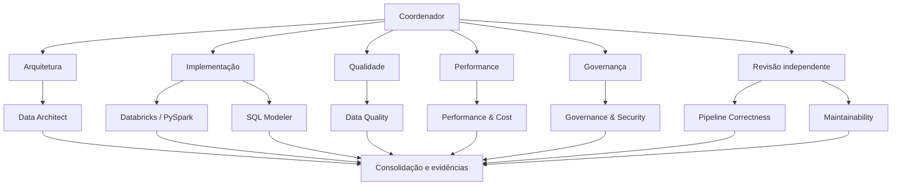

# Catálogo de agentes

O coordenador `dataengineer` decide quais perfis participarão de cada trabalho. Os oito agentes não são convocados automaticamente em toda tarefa.

| Agente | Especialidade | Entregas típicas |
|---|---|---|
| Data Architect | Requisitos, arquitetura e contratos de dados | Fluxo, contratos, grain, dependências, decisões e riscos |
| Databricks / PySpark Engineer | Python, PySpark e recursos Databricks | Implementação, notebooks, Jobs, transformação e depuração |
| SQL Data Modeler | SQL, Databricks SQL e modelagem | Consultas, joins, chaves, grain e modelos analíticos |
| Data Quality Engineer | Qualidade e testes de dados | Regras, reconciliação, integridade e regressão |
| Performance & Cost Engineer | Spark e custos de execução | Diagnóstico de plano, shuffle, skew, particionamento e medição |
| Governance & Security Reviewer | Segurança e governança de dados | Unity Catalog, menor privilégio, segredos e exposição |
| Pipeline Correctness Reviewer | Corretude independente | Achados funcionais, semântica de dados, regressões e evidências |
| Maintainability Reviewer | Manutenibilidade e simplicidade | Duplicação, complexidade acidental, legibilidade e fronteiras |

## Responsabilidade final

Os especialistas entregam análises e mudanças delimitadas. O coordenador consolida divergências, verifica evidências, comunica limitações e responde pelo resultado apresentado ao operador.
