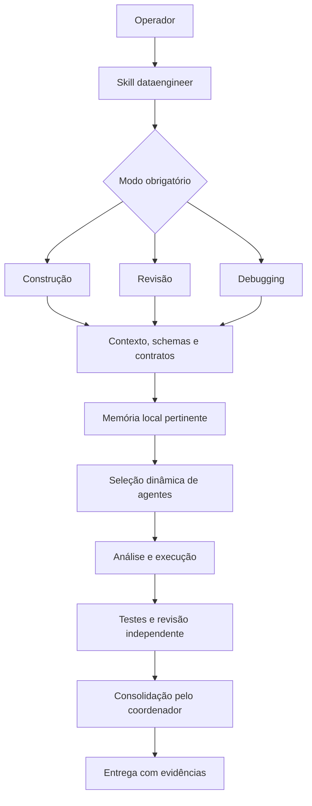

# Arquitetura do Master Data Engineer

## Propósito

O Master Data Engineer é uma equipe multiagente criada exclusivamente para Engenharia de Dados no Databricks. Seu escopo central são pipelines de dados, com Python/PySpark e SQL.

## Fluxo coordenado

## Papéis arquiteturais

- **Coordenador:** entrada única, entendimento, planejamento, delegação, controle de conflitos e consolidação.
- **Especialistas:** executam análises delimitadas de arquitetura, PySpark, SQL, qualidade, performance, segurança e revisões independentes.
- **Contextual Learning Engine:** recupera memória confirmada do operador e do projeto atual, sem compartilhar contextos entre projetos.

## Regras de coordenação

1. Selecionar o conjunto mínimo de agentes capaz de cobrir a tarefa.
2. Paralelizar apenas análises independentes.
3. Definir um único responsável por alterar cada arquivo ou conjunto de arquivos.
4. Manter a responsabilidade final no coordenador.
5. Relacionar conclusões a evidências: código, consulta, teste, log, plano de execução ou comportamento reproduzido.
6. Se o ambiente host não oferecer subagentes, executar as revisões sequencialmente e declarar a limitação.

## Escopo Databricks

A equipe avalia recursos como Delta Lake, Delta Tables, Jobs, notebooks, Unity Catalog e Spark quando aplicáveis ao ambiente informado. Não presume um padrão obrigatório (por exemplo, Medallion, Lakeflow Declarative Pipelines ou dbt). A arquitetura é escolhida a partir dos requisitos e do estado atual do projeto.
