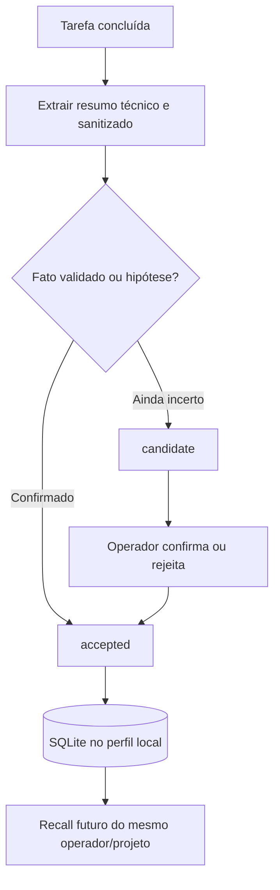

# Contextual Learning Engine

## O que é

Uma camada de memória persistente local que permite à equipe reaproveitar preferências, decisões e soluções confirmadas entre sessões. Não é treinamento de modelo, fine-tuning, alteração dos pesos da IA ou memória compartilhada centralizada.

## Escopos

- **Operador:** preferências estáveis e confirmadas que podem ser úteis em diferentes projetos.
- **Projeto:** arquitetura, contratos, regras, padrões e soluções pertencentes àquele projeto.

A recuperação combina memórias aceitas do operador com memórias aceitas do projeto atual. Outros projetos não devem aparecer na consulta. A chave do projeto é derivada de seu caminho normalizado; mover a pasta pode criar uma identidade de projeto diferente.

## Ciclo de memória

## Armazenamento

A base SQLite fica fora do repositório e do projeto Databricks. No Windows, o padrão é `%LOCALAPPDATA%\DataEngineer\Memory`. `DATAENGINEER_MEMORY_HOME` permite definir outro local. Claude Code e Codex sob a mesma conta local compartilham a memória do operador; projetos continuam isolados.

## Estados

- `candidate`: hipótese ainda não confirmada; não entra na recuperação normal.
- `accepted`: conhecimento confirmado e elegível para recall.
- `rejected`: conhecimento recusado; não utilizar.
- `superseded`: conhecimento substituído; não utilizar.

## Privacidade e limites

- Não armazenar tokens, senhas, chaves, connection strings, dados pessoais, registros de clientes ou dumps de dados.
- O detector de credenciais identifica alguns formatos comuns, mas não é um DLP completo; sanitização e revisão continuam necessárias.
- SQLite não é criptografado automaticamente. Proteja o dispositivo e o perfil local.
- Não há telemetria, rede ou sincronização automática implementadas no mecanismo. Verifique se o diretório foi redirecionado para um serviço de nuvem.
- Trechos recuperados podem ser enviados ao provedor de IA como parte do contexto da tarefa; armazenamento local não significa inferência offline.
- O mecanismo usa memória estruturada e recuperação lexical. Não há embeddings nem garantia de que todo conhecimento seja recuperado sempre.

## Gerenciamento

A skill inclui comandos para status, recall, listagem, confirmação, rejeição, esquecimento por item, exclusão por projeto e exportação solicitada. Veja `dataengineer/skills/dataengineer/references/CONTEXTUAL-LEARNING.md` no pacote de implementação para os exemplos completos.
