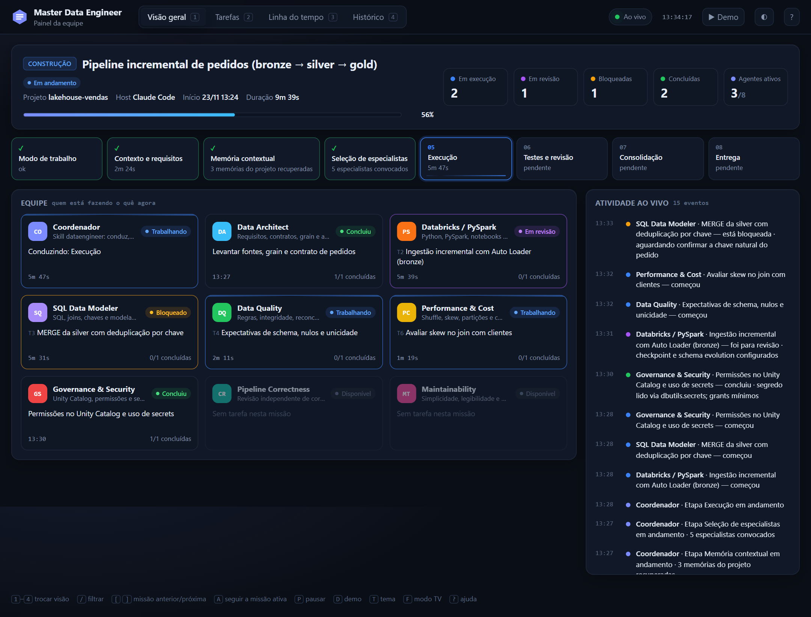

# Painel da equipe

O painel mostra, em tempo real, a missão em andamento, a etapa atual e o que cada agente está fazendo. Ele é gerado automaticamente na instalação (`~/MasterDataEngineer/painel.html`) e servido localmente em `http://127.0.0.1:47821`.



## Como abrir

| Jeito | Comando |
|---|---|
| Pela equipe | `/dataengineer` (abre ao escolher o modo) ou `/dataengineer painel` |
| Atalho | `~/MasterDataEngineer/Abrir painel.cmd` (Windows) ou `abrir-painel.sh` (macOS/Linux) |
| Terminal | `python ~/MasterDataEngineer/app/scripts/team_board.py ensure --open` |
| Arquivo | Abrir `~/MasterDataEngineer/painel.html`: conecta ao servidor se ele estiver no ar; senão mostra a última foto e a demonstração |

## Visões

| Tecla | Visão | Para quê |
|---|---|---|
| `1` | Visão geral | Missão, progresso, 8 etapas, cartão de cada agente com a tarefa atual e o tempo nela, feed ao vivo |
| `2` | Tarefas | Quadro em colunas (fila, execução, revisão, bloqueadas/falhas, concluídas) com filtro (`/`) |
| `3` | Linha do tempo | Uma raia por agente com as tarefas no tempo; listras = em execução |
| `4` | Histórico | Todas as missões; clique para abrir uma antiga |

Outros atalhos: `[`/`]` missão anterior/próxima · `A` seguir a ativa · `P` pausar · `D` demonstração · `T` tema · `F` modo TV · `?` ajuda · `Esc` fechar/limpar.

## Protocolo usado pelo coordenador

A skill chama `scripts/team_board.py` em cada passo. Os mesmos comandos podem ser usados à mão:

```bash
team_board.py start --mode construir --title "Pipeline de pedidos" --project ./lakehouse --host claude
team_board.py stage contexto                       # modo, contexto, memoria, selecao, execucao, validacao, consolidacao, entrega
team_board.py task T1 --agent data-architect --status queued --title "Contratos e grain"
team_board.py task T1 --status running
team_board.py task T1 --status done --note "grain = item do pedido"
team_board.py note "Pergunta enviada ao operador sobre a chave natural"
team_board.py finish --summary "3 notebooks, 1 Job e 12 testes"
```

Status de tarefa: `queued`, `running`, `review`, `done`, `blocked`, `failed`. Agentes: `coordinator`, `data-architect`, `databricks-pyspark-engineer`, `sql-data-modeler`, `data-quality-engineer`, `performance-cost-engineer`, `governance-security-reviewer`, `pipeline-correctness-reviewer`, `maintainability-reviewer` (aceita também os nomes do Codex com `_`).

Ao marcar uma etapa, as anteriores são fechadas automaticamente. Ao encerrar com sucesso, todas as etapas ficam concluídas.

## Hooks do Claude Code

O instalador adiciona ao `~/.claude/settings.json`:

```json
"PreToolUse":  [{ "matcher": "Task|Agent", "hooks": [{ "type": "command", "command": "\"<python>\" \"~/MasterDataEngineer/app/scripts/team_board.py\" hook" }] }],
"PostToolUse": [{ "matcher": "Task|Agent", "hooks": [{ "type": "command", "command": "...mesmo comando..." }] }]
```

- Só reage aos 8 agentes desta equipe; outros subagentes e ferramentas são ignorados.
- Se o coordenador já anunciou a tarefa (`queued`), o hook se liga a ela em vez de criar outra.
- Se não houver missão ativa, cria uma “Sessão sem missão declarada”.
- Nunca falha: qualquer erro é ignorado para não atrapalhar o agente.

Para desligar: reinstale com `MDE_NO_HOOKS=1`/`--no-hooks` depois de remover as entradas, ou rode a desinstalação.

## Dados e privacidade

- Eventos em `~/MasterDataEngineer/board/events.jsonl` (uma linha JSON por evento). Só guardam títulos e notas curtas, o nome da pasta do projeto (não o caminho) e o host.
- Textos que parecem credenciais (senhas, tokens, chaves) são substituídos por um aviso antes de serem gravados.
- O servidor só escuta em `127.0.0.1`, só responde a leituras e não libera a API a outros sites.
- `team_board.py prune --keep 30` mantém só as missões mais recentes; acima de 5 MB isso acontece sozinho.

## Variáveis de ambiente

| Variável | Padrão | Efeito |
|---|---|---|
| `DATAENGINEER_HOME` | `~/MasterDataEngineer` | Pasta do aplicativo e do histórico |
| `DATAENGINEER_BOARD_PORT` | `47821` | Porta do servidor (se ocupada, usa a próxima livre) |
| `DATAENGINEER_RUN` | missão ativa mais recente | Força os comandos a uma missão específica (útil com duas sessões em paralelo) |

## API local

| Rota | Retorno |
|---|---|
| `GET /` | O painel |
| `GET /api/health` | `{"app": "master-data-engineer", "ok": true}` |
| `GET /api/state?run=<id>` | Estado completo (missões, missão selecionada, agentes, etapas, tarefas, feed) |
| `GET /api/stream?run=<id>` | O mesmo estado por Server-Sent Events, a cada mudança |
| `GET /api/demo` | Quadros da missão de demonstração |
